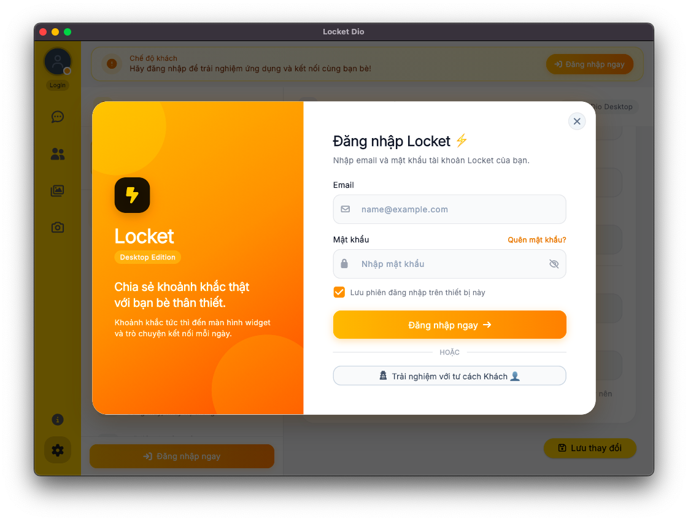
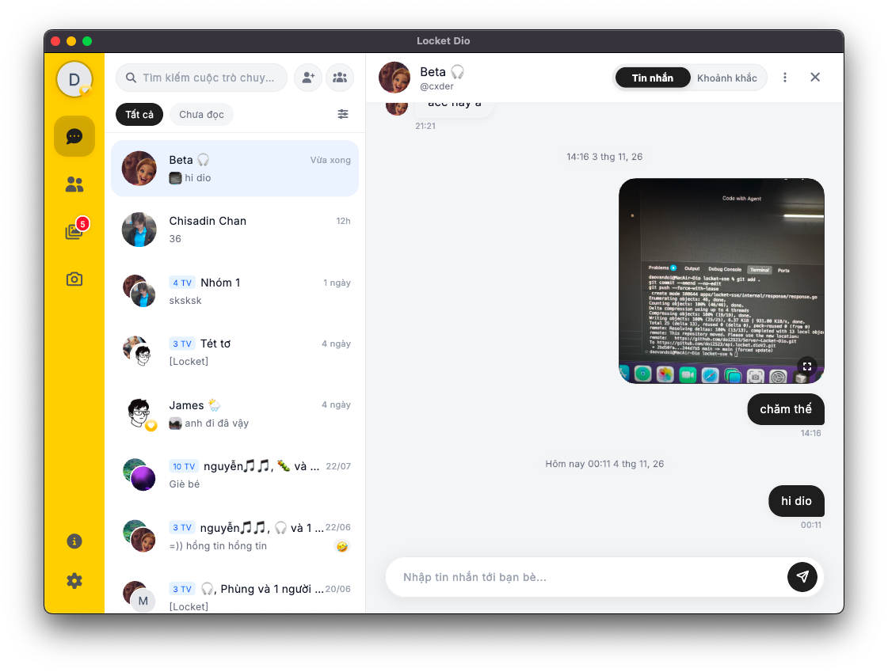
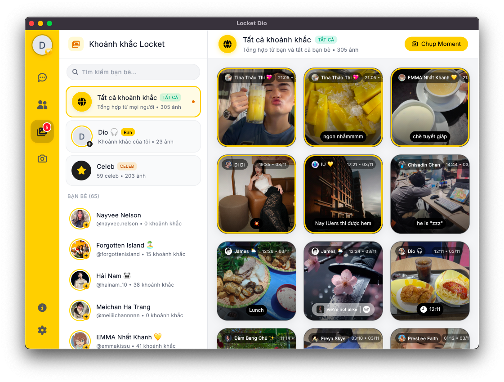
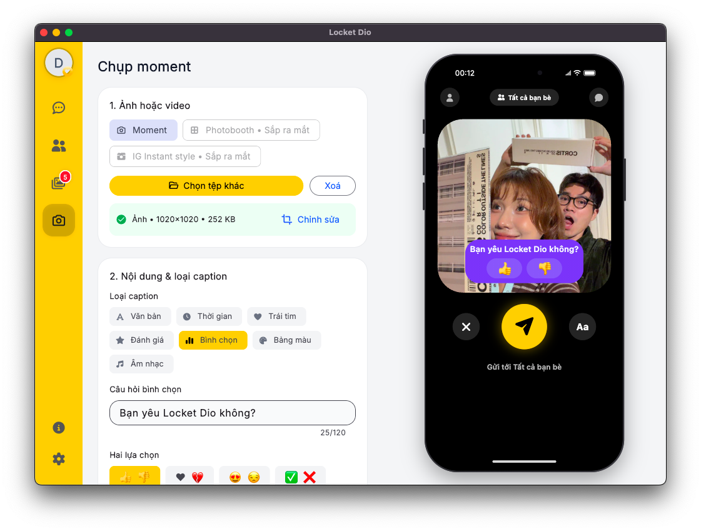
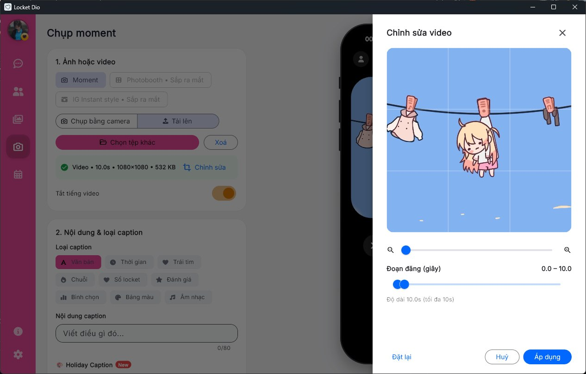
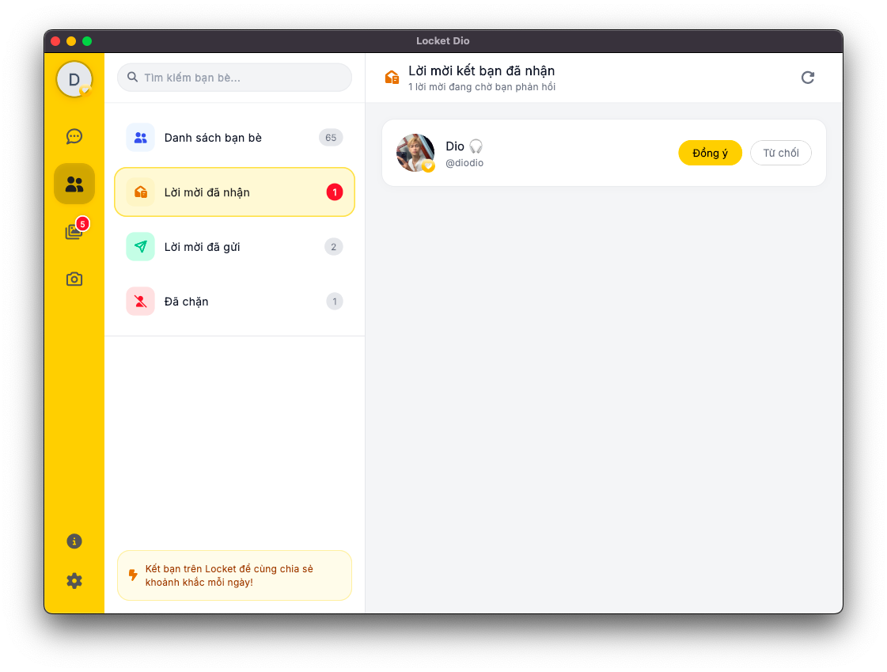
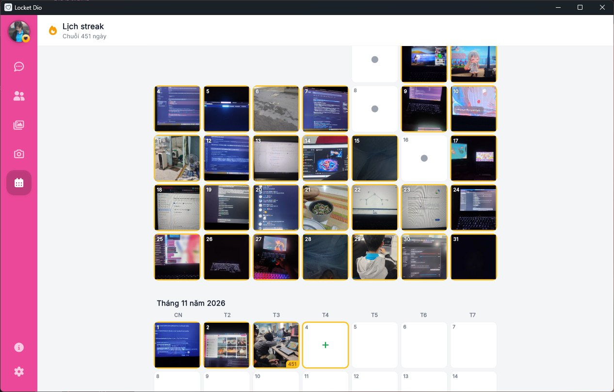
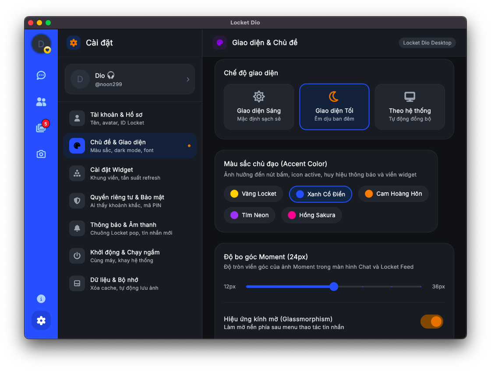
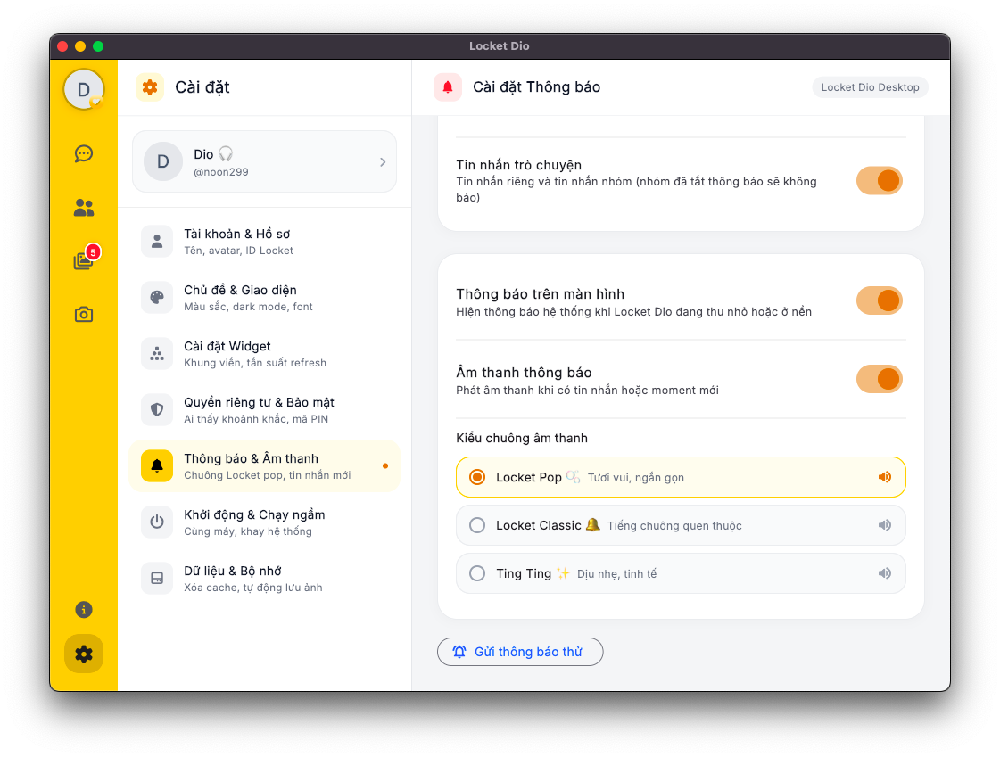
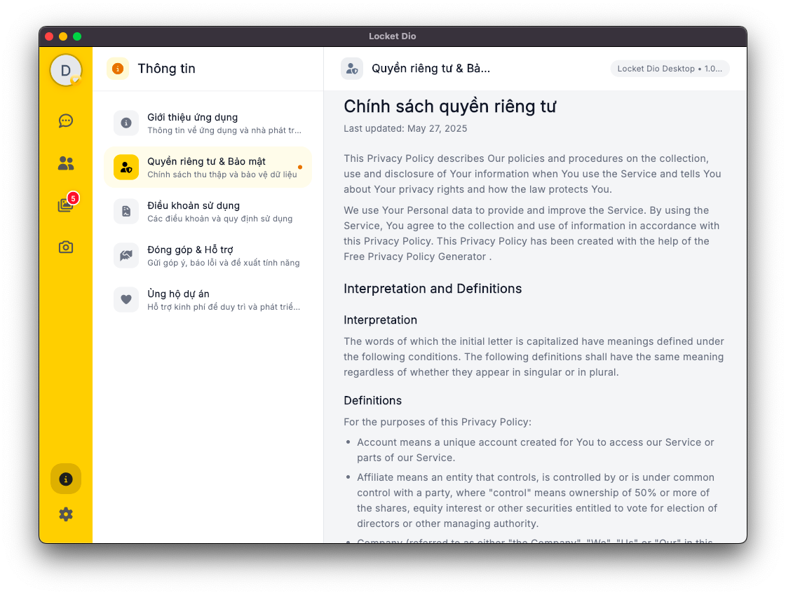

<div align="center">


# Locket Dio Desktop

**Locket for PC & Mac — view moments, chat, and share photos directly on Windows & macOS.**

[](https://github.com/doi2523/Locket-Desktop/releases/latest)
[](https://github.com/doi2523/Locket-Desktop/releases)


[**⬇️ Download**](#-download) · [Features](#-key-features) · [Screenshots](#-screenshots) · [Installation](#-installation) · [Development](#-development-guide) · [Contact & Support](#-contact--support)

[**English**](README.md) | [**🇻🇳 Tiếng Việt**](README_vi.md)

</div>

---

## 🌟 Overview

**Locket Dio Desktop** brings the complete Locket experience to desktop computers with a sleek 3-pane architecture. Combining Flutter's fluid user interface with two local background Go microservices, it delivers real-time moment streaming and messaging powered by Server-Sent Events (SSE) and gRPC.

---

## ⬇️ Download

Always grab the latest version from the [Releases Page](https://github.com/doi2523/Locket-Desktop/releases/latest):

| Operating System | Package | Notes |
| :--- | :--- | :--- |
| 🪟 **Windows** | [`LocketDio-Windows-Setup.exe`](https://github.com/doi2523/Locket-Desktop/releases/latest/download/LocketDio-Windows-Setup.exe) | Standard installer with automatic OTA updates. **Recommended.** |
| 🪟 **Windows (portable)** | [`LocketDio-Windows-Portable.zip`](https://github.com/doi2523/Locket-Desktop/releases/latest/download/LocketDio-Windows-Portable.zip) | Standalone archive — extract and run anywhere without installing. |
| 🍎 **macOS** | [`LocketDio-macOS.dmg`](https://github.com/doi2523/Locket-Desktop/releases/latest/download/LocketDio-macOS.dmg) | Disk image `.dmg` — open and drag into your *Applications* folder. |

---

## ✨ Key Features

- 🖼️ **Locket Feed** — View friends' moments in real time, filter by individuals or the exclusive Celebrity group, video auto-play, and local disk caching for instant loads.
- 💬 **Instant Messaging** — Real-time 1-on-1 and group chats powered by Server-Sent Events (SSE) and Group Relay protocol, emoji reactions, context menu, and message search.
- 📸 **Professional Post Moment Studio**:
  - Live webcam shooting or high-resolution photo/video upload from your PC.
  - **Interactive iPhone 14 Pro Max mockup** preview updates in real time with every edit.
  - Media editing suite: interactive cropping (drag, pinch/zoom), rotation, horizontal/vertical flip, and video segment trimmer (up to 10s with looping preview).
  - Rich overlays: custom text styles, live timestamp, heart counter, 5-star rating, polls, smart palette extraction, and music stickers (Spotify & Apple Music).
  - Local pre-processing: images downscaled (≤ 1920px) and videos squared (1080x1080, ≤ 10 MB) via embedded FFmpeg before upload.
  - Flexible audience selector: All Friends, Best Friends, or individual recipients.
- 🔥 **Streak Calendar** — Monthly flame streak activity tracker and instant streak recovery by posting moments.
- 👥 **Friends Hub** — Comprehensive friends directory, search, incoming and outgoing friend requests, blocked list, and verification badges (Celebrity & Locket Gold).
- 🎨 **Deep Customization** — Light / Dark / System theme matching, custom accent colors, moment corner radius adjustments, and **33 custom App Icons**.
- 🖥️ **Desktop Native Integration**:
  - Launch on Windows startup, minimize to System Tray on close, silent background running.
  - Real-time PCM audio synthesizer (`sound_synth.dart`): 3 distinct alert chimes generated via code without external audio assets.
  - Native desktop push notifications for moments, reactions, and direct messages.
- 🔄 **Over-The-Air (OTA) Updates** — Automated update checker and 1-click seamless installer.

---

## 📸 Screenshots

| 01. Login & Guest Mode | 02. Real-time Messaging |
| :---: | :---: |
|  |  |
| *Split-view authentication & seamless Guest browsing* | *3-pane layout, timeline, emoji reactions & moment sharing* |

| 03. Locket Moments Feed | 04. Post Moment Studio |
| :---: | :---: |
|  |  |
| *Stream moments with friends filter, Celeb group & auto-play* | *Live iPhone 14 Pro Max mockup preview with rich overlays* |

| 05. Media Cropper & Trimmer | 06. Friends Management Hub |
| :---: | :---: |
|  |  |
| *Interactive crop, rotate, flip & 10s looping video trimmer* | *Incoming/outgoing requests, search, Celeb & Gold badges* |

| 07. Streak Calendar Tracker | 08. Personalization & 33 App Icons |
| :---: | :---: |
|  |  |
| *Monthly flame streaks, activity log & streak restoration* | *Light/Dark/System themes, accent colors & 33 icon variants* |

| 09. System Tray & Audio Synthesizer | 10. Information & Support |
| :---: | :---: |
|  |  |
| *Startup launch, tray minimization & real-time chime synthesis* | *App metadata, policies, FAQ & Momo developer donation* |

---

## 🛠️ Installation

### Windows

1. Download [`LocketDio-Windows-Setup.exe`](https://github.com/doi2523/Locket-Desktop/releases/latest/download/LocketDio-Windows-Setup.exe) and launch the installer.
2. If Windows SmartScreen displays a warning (due to an unsigned release certificate): click **More info → Run anyway**.
3. Launch **Locket Dio** from the Start Menu or Desktop and log in with your Locket account.

### macOS

1. Download [`LocketDio-macOS.dmg`](https://github.com/doi2523/Locket-Desktop/releases/latest/download/LocketDio-macOS.dmg), open the `.dmg`, and drag **Locket Dio** into your *Applications* folder.
2. Because the app uses ad-hoc codesigning, right-click the app icon on the first launch and select **Open**, or run the quarantine removal command in Terminal:
   ```bash
   xattr -cr "/Applications/Locket Dio.app"
   ```

### OTA Updates

When an update is released, a notification will appear in the application. Simply click **Update** to download and apply it automatically. Older, unsupported client versions will prompt you to update before continuing.

---

## 🏗️ Project Architecture

```
Locket-Desktop/
├── lib/
│   ├── core/                    # Low-level networking, storage, audio synth & theme
│   │   ├── network/             # Dio client, SSE client, Session & Token manager
│   │   ├── notifications/       # Local notifications & PCM sound synthesizer
│   │   ├── platform/            # System tray, window controls & app icon switcher
│   │   ├── process/             # Background Go process manager
│   │   ├── storage/             # Disk image cache (up to 400MB) & KV store
│   │   └── theme/               # Color tokens, typography & theme settings
│   ├── features/                # Domain-driven feature modules (Riverpod)
│   │   ├── auth/                # Login overlay, dual-column layout & Guest mode
│   │   ├── chat/                # Real-time chat list, timeline, group creation
│   │   ├── friends/             # Friends list, requests, search & blocklist
│   │   ├── home/                # Responsive layout shell (Desktop Rail vs Mobile Bar)
│   │   ├── info/                # App metadata, terms, privacy policy & Momo donate
│   │   ├── locket_feed/         # Moments stream, friend filter & seen tracking
│   │   ├── navigation/          # Desktop 76px Navigation Rail & Mobile Bottom Bar
│   │   ├── post_moment/         # iPhone 14 Pro Max mockup, cropper & video trimmer
│   │   ├── settings/            # Theme, system, sound, cache & account settings
│   │   └── streak/              # Flame streak calendar & restore workflow
│   └── shared/                  # Shared components (Avatar, Skeletons, CacheImage)
│
├── server/                      # Embedded Local Microservices (Go)
│   ├── locket-grpc/             # Local high-speed gRPC engine
│   └── locket-sse/              # SSE event relay & connection broker
│
├── assets/                      # Bundled resources
│   ├── app_icons/               # 33 application icon sets (.ico & .png)
│   ├── icons/                   # Verification badges (Celebrity, Locket Gold)
│   ├── images/                  # Static assets & Momo donation QR
│   ├── legal/                   # Markdown documents for Terms & Privacy
│   └── screenshots/             # Documentation screenshots
└── ffmpeg/                      # Bundled FFmpeg binary (packaged via CI)
```

---

## 💻 Development Guide

### Prerequisites
- **Flutter SDK**: `stable` channel (Dart 3.x+).
- **Go SDK**: `1.21+` (to compile the two embedded local microservices).
- **FFmpeg**: Installed in system `PATH` or placed inside the `ffmpeg/` folder.

### Running Locally

```bash
# Fetch Flutter packages
flutter pub get

# Launch on Windows
flutter run -d windows

# Launch on macOS
flutter run -d macos
```

### Static Analysis & Testing

```bash
flutter analyze
flutter test
```

---

## 🎬 FFmpeg Integration

Locket Dio Desktop requires FFmpeg for video clipping, cropping, and compression. The application resolves FFmpeg in the following order:

1. `LOCKET_FFMPEG` environment variable.
2. `<AppDirectory>/ffmpeg/ffmpeg.exe` (Windows) or `<AppDirectory>/ffmpeg/ffmpeg` (macOS).
3. System `PATH`.

*Static photo posting does not require FFmpeg.*

---

## 📬 Contact & Support

- ✉️ Email: [doibncm2003@gmail.com](mailto:doibncm2003@gmail.com)
- 💬 Telegram: [t.me/+MjfI6qspzYZmNzRl](https://t.me/+MjfI6qspzYZmNzRl)
- 🎮 Discord: [discord.com/invite/47buy9nMGc](https://discord.com/invite/47buy9nMGc)
- 🌐 Website: [locket-dio.com](https://locket-dio.com)
- 🐞 Bug reports & Feature requests: open an [Issue on GitHub](https://github.com/doi2523/Locket-Desktop/issues) or reach out via the community links above.

> 💡 *Tip*: In the app under **Settings → Info → Contribution & Support**, use the quick copy button to capture system diagnostic details (app version, OS).

---

## Star History

<a href="https://www.star-history.com/?repos=doi2523%2FLocket-Desktop&type=date&legend=top-left">
 <picture>
   <source media="(prefers-color-scheme: dark)" srcset="https://api.star-history.com/chart?repos=doi2523/Locket-Desktop&type=date&theme=dark&legend=top-left" />
   <source media="(prefers-color-scheme: light)" srcset="https://api.star-history.com/chart?repos=doi2523/Locket-Desktop&type=date&legend=top-left" />
   
 </picture>
</a>

---

<div align="center">

**Locket Dio Desktop** is developed by [Đào Văn Đôi (Dio)](https://github.com/doi2523).

<sub>This is an independent open-source project and is not officially affiliated with Locket Labs. Locket is a trademark of its respective owner.</sub>

</div>
