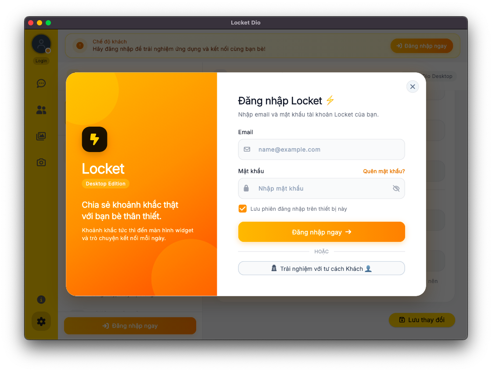
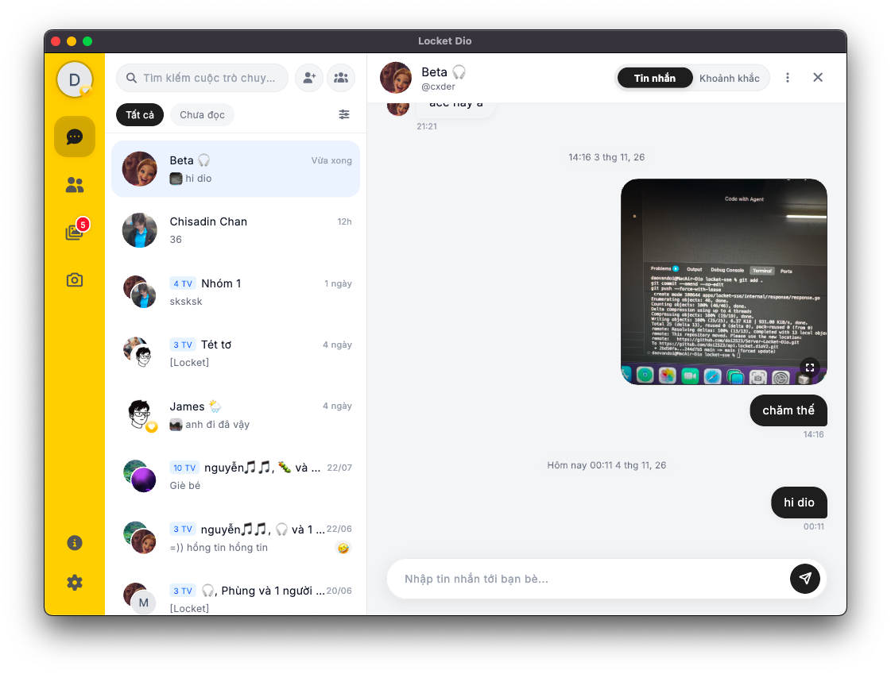
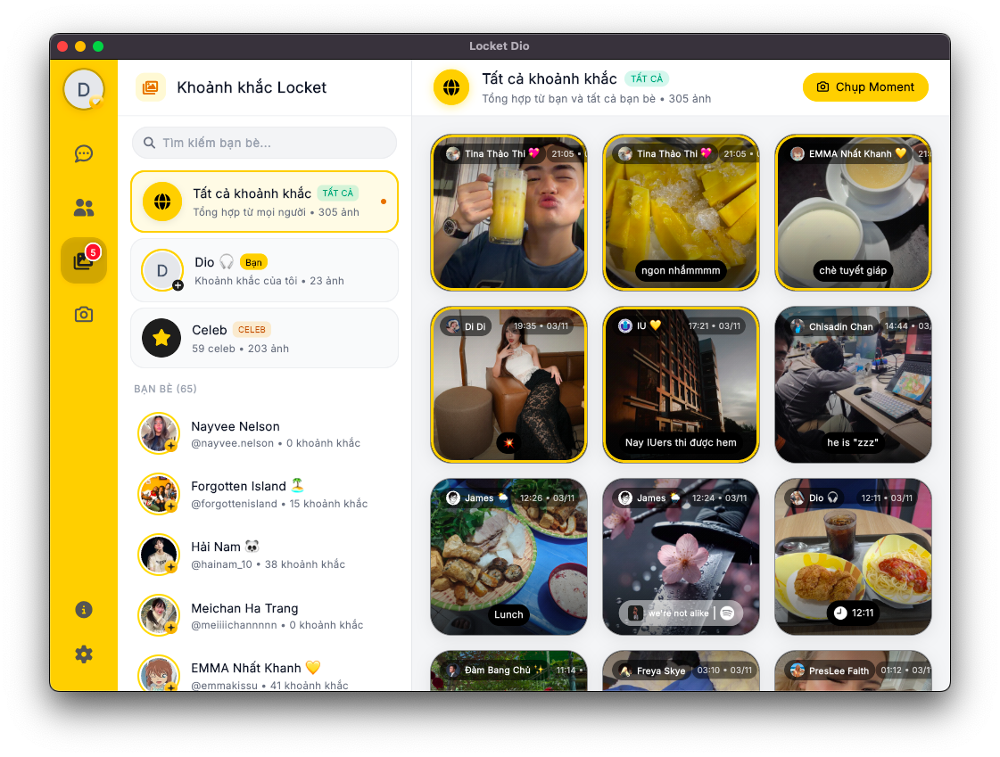
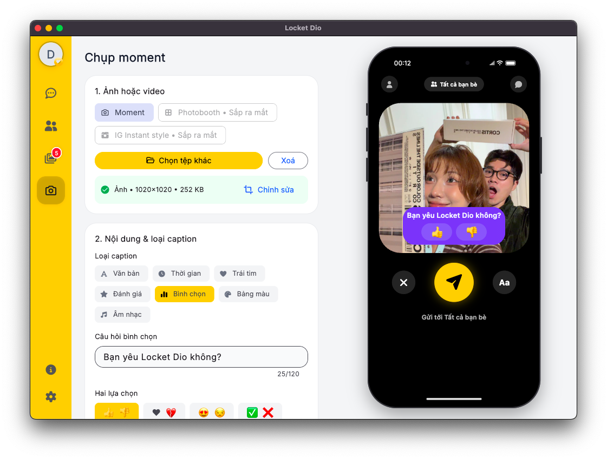
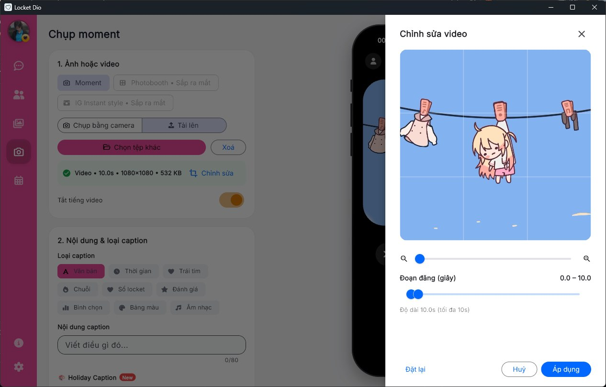
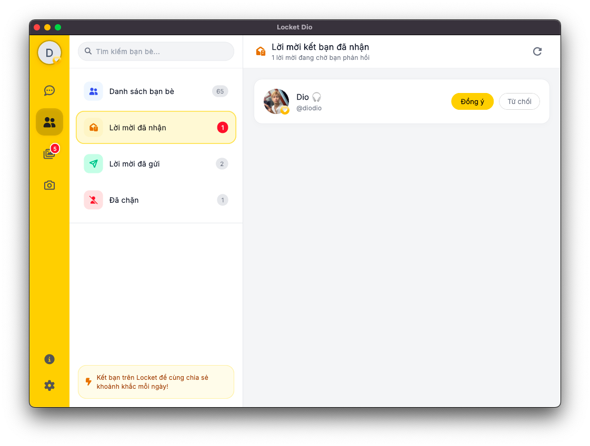
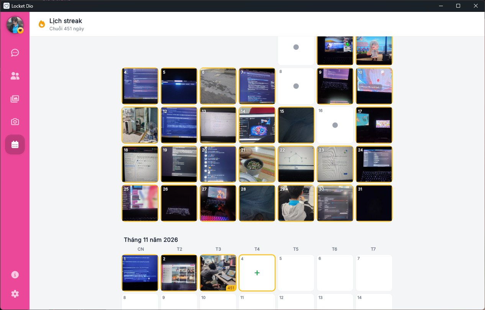
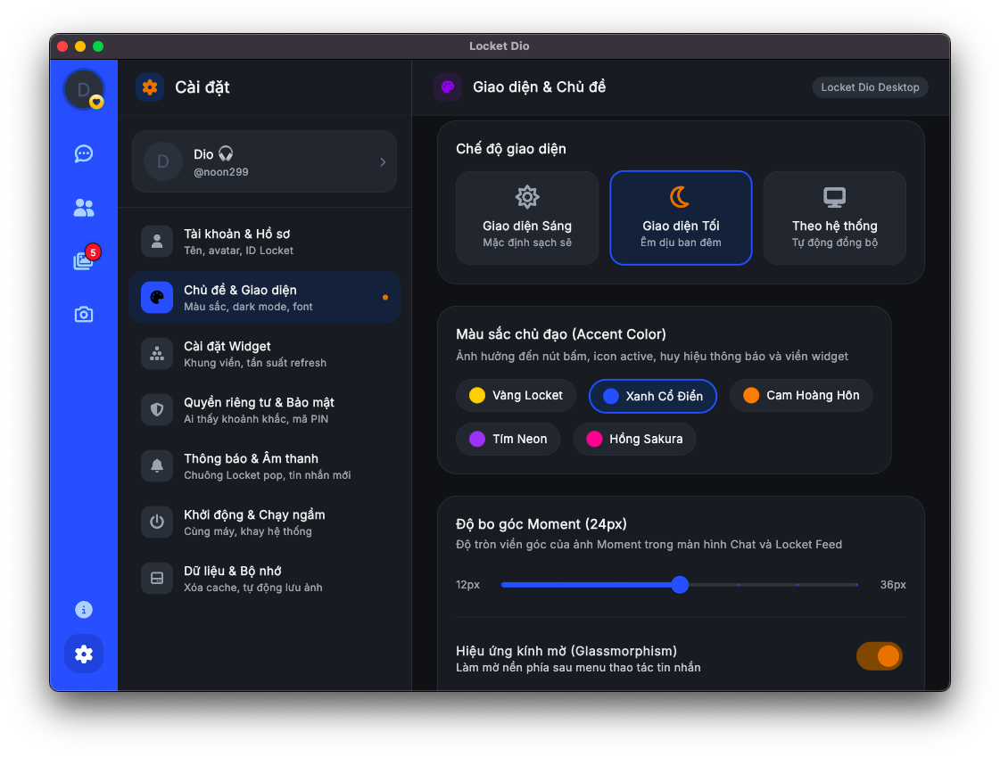
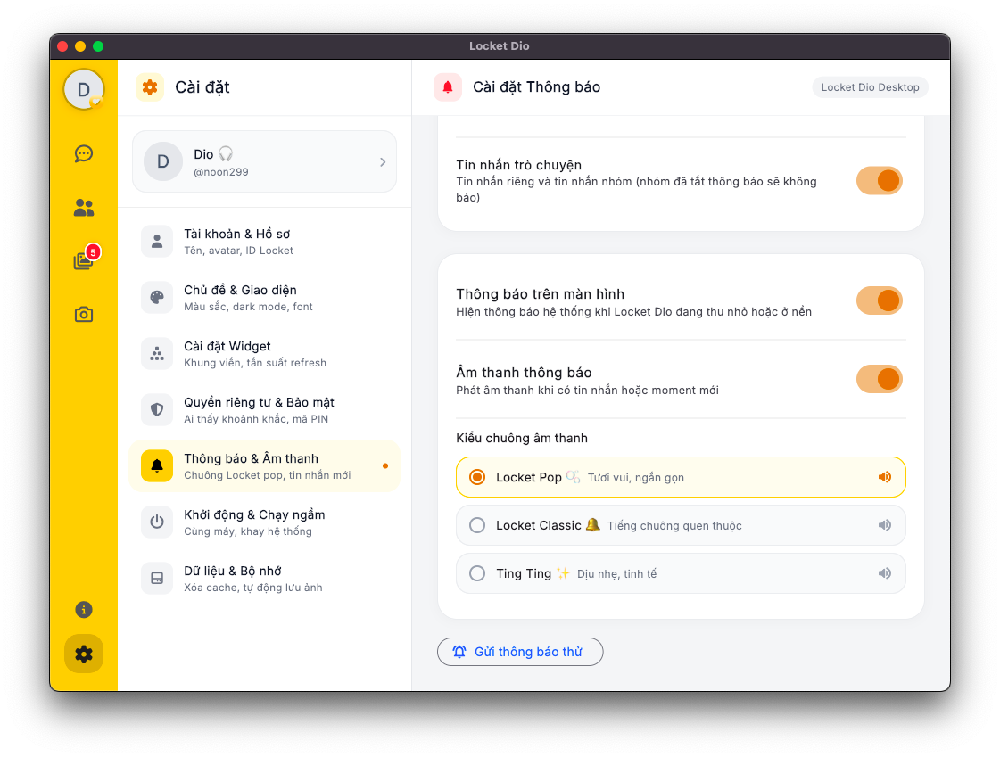
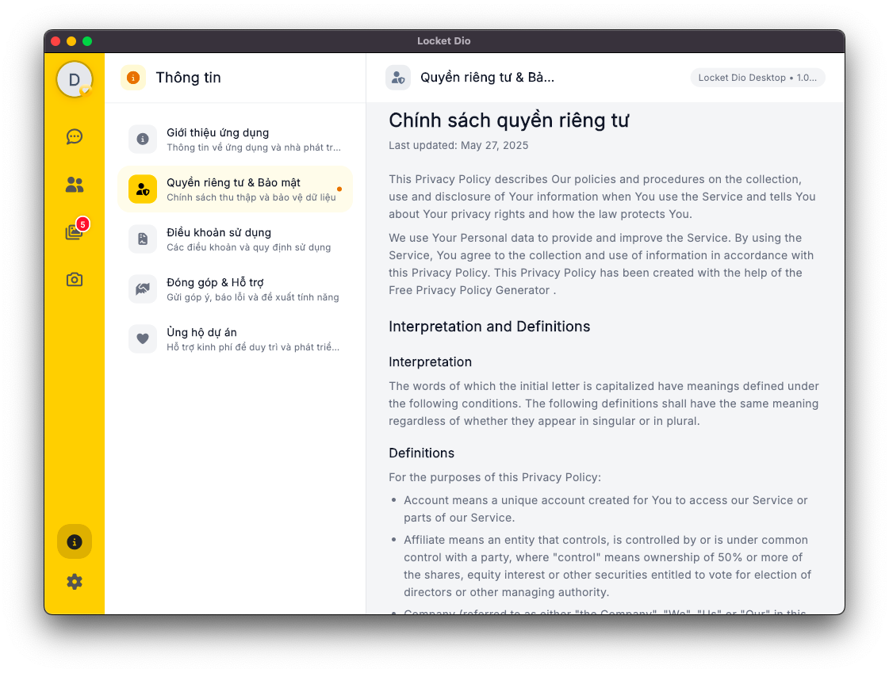

<div align="center">


# Locket Dio Desktop

**Locket trên máy tính — xem khoảnh khắc, nhắn tin và đăng moment ngay trên Windows & macOS.**

[](https://github.com/doi2523/Locket-Desktop/releases/latest)
[](https://github.com/doi2523/Locket-Desktop/releases)


[**⬇️ Tải về**](#-tải-về) · [Tính năng](#-tính-năng) · [Ảnh chụp màn hình](#-ảnh-chụp-màn-hình) · [Cài đặt](#-hướng-dẫn-cài-đặt) · [Phát triển](#-hướng-dẫn-phát-triển) · [Liên hệ & hỗ trợ](#-liên-hệ--hỗ-trợ)

[**🇻🇳 Tiếng Việt**](README_vi.md) | [**🇺🇸 English**](README.md)

</div>

---

## 🌟 Giới thiệu

**Locket Dio Desktop** mang trọn vẹn trải nghiệm kết nối khoảnh khắc của Locket lên màn hình máy tính với kiến trúc 3 cột (3-pane) chuẩn desktop. Ứng dụng kết hợp giao diện mượt mà của Flutter cùng 2 dịch vụ Go chạy ngầm cục bộ để truyền phát dữ liệu thời gian thực qua Server-Sent Events (SSE) và gRPC.

---

## ⬇️ Tải về

Luôn có bản mới nhất tại [trang Releases](https://github.com/doi2523/Locket-Desktop/releases/latest):

| Hệ điều hành | Tệp tải | Ghi chú |
| :--- | :--- | :--- |
| 🪟 **Windows** | [`LocketDio-Windows-Setup.exe`](https://github.com/doi2523/Locket-Desktop/releases/latest/download/LocketDio-Windows-Setup.exe) | Bộ cài đặt tự động, hỗ trợ tự cập nhật (OTA). **Khuyên dùng.** |
| 🪟 **Windows (portable)** | [`LocketDio-Windows-Portable.zip`](https://github.com/doi2523/Locket-Desktop/releases/latest/download/LocketDio-Windows-Portable.zip) | Bản nén giải nén chạy ngay, không cần cài đặt. |
| 🍎 **macOS** | [`LocketDio-macOS.dmg`](https://github.com/doi2523/Locket-Desktop/releases/latest/download/LocketDio-macOS.dmg) | File ảnh đĩa `.dmg`, mở ra và kéo vào thư mục *Applications*. |

---

## ✨ Tính năng nổi bật

- 🖼️ **Locket Feed** — xem khoảnh khắc bạn bè theo thời gian thực, lọc theo cá nhân/nhóm Celeb, tự phát video, lưu bộ nhớ đệm mở lên có ngay.
- 💬 **Nhắn tin tức thì** — trò chuyện 1-1 và nhóm thời gian thực qua Server-Sent Events (SSE) + Group Relay, thả cảm xúc emoji, menu ngữ cảnh & tìm kiếm tin nhắn.
- 📸 **Studio đăng moment chuyên nghiệp**:
  - Chụp trực tiếp bằng webcam máy tính hoặc tải ảnh/video chất lượng cao từ máy.
  - **Khung xem trước iPhone 14 Pro Max sống động** cập nhật trực tiếp theo mọi thay đổi.
  - Bộ công cụ cắt ảnh tự do (kéo, phóng to, xoay, lật ảnh) và cắt video trực quan (tối đa 10s, looping preview).
  - Caption đa dạng: văn bản, thời gian thực, trái tim, đánh giá 5 sao, bình chọn, trích xuất bảng màu thông minh, nhãn dán nhạc (Spotify & Apple Music).
  - Xử lý nén ảnh (≤ 1920px) và cắt vuông video (1080x1080, ≤ 10 MB) ngay trên máy bằng FFmpeg nhúng trước khi gửi.
  - Tùy chọn người nhận: Tất cả bạn bè, bạn thân hoặc chọn người nhận cụ thể.
- 🔥 **Lịch streak** — theo dõi chuỗi ngọn lửa theo từng tháng và đăng moment khôi phục chuỗi ngày bị đứt.
- 👥 **Trung tâm bạn bè** — quản lý danh bạ bạn bè, lời mời kết bạn đã nhận/đã gửi, danh sách chặn, huy hiệu xác minh Celebrity & Locket Gold.
- 🎨 **Tuỳ biến giao diện sâu** — chế độ Sáng/Tối/Hệ thống, chọn màu nhấn, điều chỉnh độ bo góc moment, đổi giữa **33 biểu tượng ứng dụng (App Icons)** độc quyền.
- 🖥️ **Tích hợp sâu hệ điều hành**:
  - Khởi động cùng Windows, thu nhỏ chạy ngầm dưới khay hệ thống (System Tray).
  - Bộ tổng hợp âm thanh PCM (`sound_synth.dart`): 3 kiểu chuông báo thời gian thực không tốn dung lượng file.
  - Thông báo đẩy màn hình khi có moment mới, reaction hoặc tin nhắn.
- 🔄 **Tự cập nhật (OTA)** — ứng dụng tự kiểm tra, thông báo khi có phiên bản mới và cài đặt nhanh chóng chỉ với một cú bấm.

---

## 📸 Ảnh chụp màn hình

| 01. Đăng nhập & Chế độ Khách | 02. Nhắn tin thời gian thực |
| :---: | :---: |
|  |  |
| *Giao diện đăng nhập 2 cột hiện đại & duyệt trải nghiệm ở chế độ Khách* | *Bố cục 3 cột, timeline mượt mà, thả cảm xúc emoji & chia sẻ moment* |

| 03. Locket Moments Feed | 04. Studio Đăng khoảnh khắc |
| :---: | :---: |
|  |  |
| *Dòng khoảnh khắc bạn bè, bộ lọc cá nhân / nhóm Celeb & tự phát video* | *Khung xem trước iPhone 14 Pro Max live cùng hệ thống caption phong phú* |

| 05. Công cụ Cắt & Cắt tỉa Video | 06. Quản lý Bạn bè (Friends Hub) |
| :---: | :---: |
|  |  |
| *Kéo, zoom, xoay/lật ảnh và thanh trượt cắt video tối đa 10s vòng lặp* | *Quản lý lời mời đã nhận/đã gửi, tìm kiếm, huy hiệu Celeb & Locket Gold* |

| 07. Lịch theo dõi Streak ngọn lửa | 08. Giao diện & 33 Biểu tượng App |
| :---: | :---: |
|  |  |
| *Số ngày streak ngọn lửa, nhật ký hoạt động tháng & khôi phục streak* | *Chế độ Sáng/Tối/Hệ thống, bảng màu nhấn & 33 app icon độc đáo* |

| 09. Chạy ngầm Khay & Âm thanh tổng hợp | 10. Thông tin & Ủng hộ nhà phát triển |
| :---: | :---: |
|  |  |
| *Khởi động cùng Windows, thu nhỏ vào khay & 3 kiểu chuông synth PCM* | *Thông tin phiên bản, điều khoản dịch vụ & mã QR Momo ủng hộ tác giả* |

---

## 🛠️ Hướng dẫn cài đặt

### Windows

1. Tải file [`LocketDio-Windows-Setup.exe`](https://github.com/doi2523/Locket-Desktop/releases/latest/download/LocketDio-Windows-Setup.exe) và mở lên.
2. Nếu Windows SmartScreen hiện cảnh báo (do ứng dụng mới phát hành chưa có chữ ký số trả phí): bấm chọn **Thông tin thêm (More info) → Vẫn chạy (Run anyway)**.
3. Mở **Locket Dio** từ Start Menu hoặc Desktop và đăng nhập bằng tài khoản Locket của bạn.

### macOS

1. Tải [`LocketDio-macOS.dmg`](https://github.com/doi2523/Locket-Desktop/releases/latest/download/LocketDio-macOS.dmg), mở file `.dmg` và kéo biểu tượng **Locket Dio** vào thư mục *Applications*.
2. Ứng dụng ký mã ad-hoc (chưa mua chứng chỉ Apple Developer), nên ở lần mở đầu tiên hãy **chuột phải vào app → chọn Mở (Open)**, hoặc mở Terminal và chạy lệnh gỡ cách ly:
   ```bash
   xattr -cr "/Applications/Locket Dio.app"
   ```

### Cơ chế cập nhật OTA

Khi có phiên bản mới, ứng dụng sẽ hiện thông báo ở góc màn hình. Bạn chỉ cần bấm **Cập nhật** để tự động tải và áp dụng. Nếu phiên bản hiện tại quá cũ không còn tương thích API máy chủ, ứng dụng sẽ chuyển sang màn hình nhắc nhở cập nhật để bảo đảm an toàn dữ liệu.

---

## 🏗️ Kiến trúc dự án

```
Locket-Desktop/
├── lib/
│   ├── core/                    # Mạng, lưu trữ, âm thanh synth & theme
│   │   ├── network/             # Dio client, SSE client, Session & Token manager
│   │   ├── notifications/       # Thông báo hệ thống & Bộ tổng hợp âm thanh PCM
│   │   ├── platform/            # Quản lý khay hệ thống, kích thước cửa sổ & app icon
│   │   ├── process/             # Quản lý tiến trình dịch vụ Go chạy ngầm
│   │   ├── storage/             # Cache ảnh đĩa cứng (tối đa 400MB) & local KV cache
│   │   └── theme/               # Bảng màu, typography & thiết lập giao diện
│   ├── features/                # Các module nghiệp vụ theo chuẩn domain (Riverpod)
│   │   ├── auth/                # Màn hình đăng nhập 2 cột, hỗ trợ chế độ Khách
│   │   ├── chat/                # Danh sách chat, timeline tin nhắn, tạo nhóm
│   │   ├── friends/             # Bạn bè, lời mời, tìm kiếm & danh sách chặn
│   │   ├── home/                # Khung điều hướng đa màn hình (Desktop Rail vs Mobile Bar)
│   │   ├── info/                # Thông tin ứng dụng, điều khoản, quyền riêng tư & Momo
│   │   ├── locket_feed/         # Dòng khoảnh khắc bạn bè, lọc bạn & trạng thái đã xem
│   │   ├── navigation/          # Thanh điều hướng Desktop (76px) & Mobile Bottom Bar
│   │   ├── post_moment/         # Mockup iPhone 14 Pro Max, bộ cắt ảnh & cắt tỉa video
│   │   ├── settings/            # Cài đặt giao diện, hệ thống, âm thanh, bộ nhớ & tài khoản
│   │   └── streak/              # Lịch streak ngọn lửa & luồng khôi phục
│   └── shared/                  # Reusable widgets (Avatar, Skeletons, CacheImage)
│
├── server/                      # Microservices Go chạy ngầm cục bộ
│   ├── locket-grpc/             # Dịch vụ gRPC nội bộ hiệu năng cao
│   └── locket-sse/              # Trạm trung chuyển sự kiện Server-Sent Events
│
├── assets/                      # Tài nguyên ứng dụng
│   ├── app_icons/               # 33 bộ icon ứng dụng (.ico & .png)
│   ├── icons/                   # Huy hiệu Celebrity, Locket Gold
│   ├── images/                  # Ảnh nền, mã QR Momo ủng hộ
│   ├── legal/                   # Điều khoản dịch vụ và chính sách bảo mật
│   └── screenshots/             # Ảnh chụp màn hình dùng cho tài liệu
└── ffmpeg/                      # File thực thi FFmpeg (tự động đóng gói qua CI)
```

---

## 💻 Hướng dẫn phát triển

### Yêu cầu môi trường
- **Flutter SDK**: Kênh `stable` (Dart 3.x+).
- **Go SDK**: Phiên bản `1.21+` (để build 2 dịch vụ ngầm).
- **FFmpeg**: Có sẵn trong `PATH` hoặc đặt tại thư mục `ffmpeg/` của ứng dụng.

### Chạy ứng dụng

```bash
# Cài đặt gói phụ thuộc
flutter pub get

# Chạy trên Windows
flutter run -d windows

# Chạy trên macOS
flutter run -d macos
```

### Kiểm tra mã nguồn & Kiểm thử

```bash
flutter analyze
flutter test
```

---

## 🎬 Tích hợp FFmpeg

Locket Dio Desktop sử dụng FFmpeg để nén, cắt tỉa và chuẩn hóa video thành khung vuông 1080px. Thứ tự nhận diện FFmpeg của app:

1. Biến môi trường `LOCKET_FFMPEG`.
2. `<Thư mục app>/ffmpeg/ffmpeg.exe` (Windows) hoặc `<Thư mục app>/ffmpeg/ffmpeg` (macOS).
3. Biến môi trường hệ thống `PATH`.

*Chế độ đăng ảnh tĩnh thông thường không yêu cầu FFmpeg.*

---

## 📬 Liên hệ & hỗ trợ

- ✉️ Email: [doibncm2003@gmail.com](mailto:doibncm2003@gmail.com)
- 💬 Telegram: [t.me/+MjfI6qspzYZmNzRl](https://t.me/+MjfI6qspzYZmNzRl)
- 🎮 Discord: [discord.com/invite/47buy9nMGc](https://discord.com/invite/47buy9nMGc)
- 🌐 Website: [locket-dio.com](https://locket-dio.com)
- 🐞 Báo lỗi / đề xuất tính năng: mở một [Issue trên GitHub](https://github.com/doi2523/Locket-Desktop/issues) hoặc nhắn qua các kênh hỗ trợ bên trên.

> 💡 *Mẹo*: Trong ứng dụng, mục **Cài đặt → Thông tin → Đóng góp & Hỗ trợ** có nút sao chép nhanh thông tin báo lỗi hệ thống (phiên bản, hệ điều hành).

---

## Star History

<a href="https://www.star-history.com/?repos=doi2523%2FLocket-Desktop&type=date&legend=top-left">
 <picture>
   <source media="(prefers-color-scheme: dark)" srcset="https://api.star-history.com/chart?repos=doi2523/Locket-Desktop&type=date&theme=dark&legend=top-left" />
   <source media="(prefers-color-scheme: light)" srcset="https://api.star-history.com/chart?repos=doi2523/Locket-Desktop&type=date&legend=top-left" />
   
 </picture>
</a>

---

<div align="center">

**Locket Dio Desktop** do [Đào Văn Đôi (Dio)](https://github.com/doi2523) phát triển.

<sub>Ứng dụng mã nguồn mở độc lập, không liên kết chính thức với Locket Labs. Locket là thương hiệu của chủ sở hữu tương ứng.</sub>

</div>
